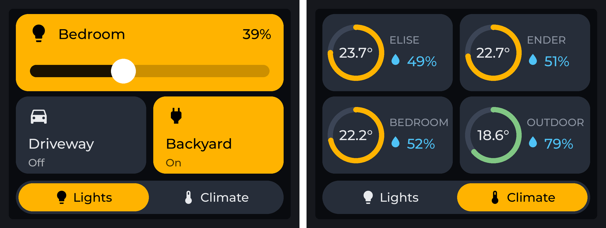

# CYD Home Assistant Remote

A touch remote for Home Assistant on the **ESP32-2432S028R** ("Cheap Yellow Display", 2.8" resistive touch), built with ESPHome and LVGL.

- **Lights page:** large tiles. Bedroom has an in-tile dimmer that appears when the light is on; Driveway and Backyard are on/off.
- **Climate page:** four gauge rings (temperature) with humidity for each room and outdoors.
- Amber on charcoal theme, Material Design Icons, backlight dims after 30 s and wakes on touch.

*Images are renders of the layout (Bedroom at 39%, Backyard on), not photos. Individual pages: [`lights-page.png`](images/lights-page.png), [`climate-page.png`](images/climate-page.png).*

## Setup

1. Copy `secrets.yaml.example` to `secrets.yaml` in your ESPHome config folder and fill it in.
2. Copy `cyd-remote.yaml` into the ESPHome dashboard and edit the `entity_id` values (lights, switch, and the `sensor.*_temperature` / `*_humidity` entities).
3. Flash over USB the first time (the build downloads the icon font from GitHub, so it needs internet access).
4. Add the device in Home Assistant, then enable **Allow the device to perform Home Assistant actions** under Settings > Devices & services > ESPHome > CYD Remote > Configure. Without this, taps update the screen but do not control anything.

## Board notes (what worked on my unit)

- Display model `esp32-2432S028` (ILI9341) with `lvgl: rotation: 90` gives a correct landscape picture with the USB port on the right.
- Tried and rejected on this board: `esp32-2432S028-7789` (blank white screen) and `esp32-2432S028-9342` (garbled, mirrored picture). Other board revisions may differ.
- Touch calibration comes from logging raw XPT2046 values at the four corners. If taps land in the wrong place, adjust `calibration:` and `transform:` under `touchscreen:`.
- Dark colors look slightly blue on this TN panel, especially off-axis.
- `power_save_mode: none` is set on Wi-Fi; with the default, Home Assistant had trouble connecting to the device's API.
